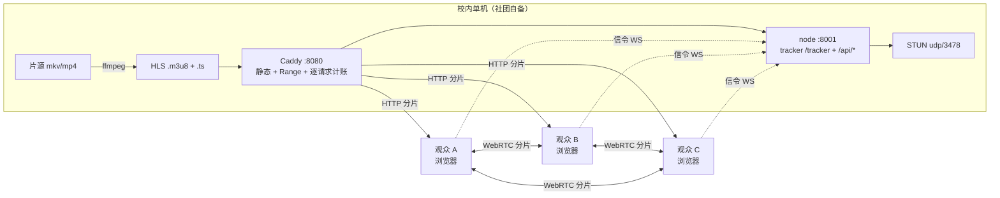

# 优化后的部署方案（由实测数字约束）

本文件是 `report/hitsz-p2p-findings.md` 的施工版。所有参数标注了它的实测依据或未验证状态；
没有依据的地方一律写明「待现场测量」，不写成结论。

## 1. 拓扑



关键量（实测，N=3、2.5 Mbps）：源站出口 ≈ **1 × 码流**（2.71 Mbps），每观众上行 ≈ **1.81 Mbps**，
每观众连接数 2，稳态 P2P 66.7%（= 上限）。源站不再随人数线性增长，压力转移到观众上行与 AP 聚合。

## 2. 转码

已验证可用（本仓库测试片源即此参数产出，4 s 分片、61 片、78 MB）：

```bash
ffmpeg -re -i input.mkv \
  -c:v libx264 -preset veryfast -profile:v main \
  -b:v 2500k -maxrate 2800k -bufsize 5000k \
  -g 100 -keyint_min 100 -sc_threshold 0 \
  -c:a aac -b:a 128k -ac 2 \
  -f hls -hls_time 4 -hls_list_size 0 \
  -hls_segment_filename "/srv/hls/stream/seg_%04d.ts" \
  /srv/hls/stream/index.m3u8
```

要点与依据：

- **`-g`/`-keyint_min`/`-sc_threshold 0` 必须写死**，让关键帧对齐 4 s 分片边界；否则分片边界与
  关键帧错位，切片时插入的位移会放大体积，P2P 传输的分片大小不均也会拖慢同步。
- **`-re` 只在直播/模拟推流时用**；离线转码去掉 `-re` 才能全速跑。
- 码率按现场上行选：**优先 720p / 1.2–1.8 Mbps**。理由是总量守恒——
  每观众上行 ≈ 码流，AP 聚合 ≈ N × 码流（见 §6 表），压码率对 AP 是线性收益。
- 送审/彩排用的点播可另出一份 1080p 2.5 Mbps，放映当晚按现场负载二选一。

## 3. 静态分发（Caddy）

本仓库 `caddy/Caddyfile` 即成品，三个非默认点都是踩坑结论：

| 配置 | 为什么 |
|---|---|
| `header @segment Content-Type "video/mp2t"` | Caddy 的 MIME 表把 `.ts` 映射到 `text/vnd.trolltech.linguist`（Qt 翻译文件）。不覆盖会让部分播放器/代理按文本处理分片 |
| `header @manifest Cache-Control "no-store"` 与 `@segment ... immutable` | m3u8 必须每次取新，分片可永久缓存；混用会导致「换了片源还播旧的」或「每片都回源」 |
| `log ... format json` + `size` 字段 | 逐请求字节数是 P2P 占比的独立第二口径。注意字段名是 `size`（响应体），不是 `bytes_written`（此处为 null） |

Range 由 `file_server` 原生支持，`check-stack.sh` 用 `Range: bytes=0-1` 断言必须返回 **206**。

`check-stack.sh` 共 9 项断言：播放页、`<video>` 元素、播放器 bundle、m3u8 结构、分片 Range(206)、
分片 Content-Type、`/api/health`+`/api/stats` JSON、tracker WS 握手、**STUN binding 回显源地址**。
最后一项是跨子网直连的必要条件（Chrome 用 mDNS 隐藏 host 候选），因此不能只看进程存活 ——
脚本会主动发一个 RFC 5389 Binding 请求并核对 `XOR-MAPPED-ADDRESS` 的端口是否等于自己的源端口。

## 4. 控制面（tracker + STUN）

```bash
bash scripts/start.sh     # 起 node(:8001, tracker+STUN) 与 caddy(:8080)
bash scripts/stop.sh      # 干净收掉，无残留
```

- tracker 用 `bittorrent-tracker` 的 WS `noServer` 模式挂在同一进程，经 Caddy 反代 `/tracker`。
  选它而不选 `wt-tracker`：后者依赖 `uWebSockets.js` 的 GitHub 预编译包，在离线/无构建环境的校内机器上
  装不上；纯 JS 版只吃 CPU，200 人的 annouce 广播压力可以接受（**未压测**，见 §8）。
- **STUN 必须自建在校内**：Chrome 把 host 候选替换成 `.local`（mDNS），跨子网不可解析；
  校内 STUN 返回的 `srflx` 就是观众自己的校园网地址，对方可直接路由。实测 1898 次 Binding 请求、
  825 次来自 `10.249.x.x`，说明这条路径确实在用。
- 端口全部高位（8080/8001/3478 UDP），全程用户态，`Ctrl-C` 即净。不需要 `sudo`、systemd、TLS。

## 5. 播放器参数（每个都有实测理由）

| 参数 | 值 | 依据 |
|---|---|---|
| `httpDownloadTimeWindow` | **60**（不可低于 ~30） | 压到 10 s 时 2/3 观众冻在 4.0 s、零 HTTP 兜底；60 s 时稳态正常 |
| `p2pDownloadTimeWindow` | **120** | 默认 6000 s 导致每个观众 6 s 内预取 75.7 MB（整条流），播放头卡住 |
| `maxBufferLength` / `maxMaxBufferLength` | 20 / 40 | 缓冲越深、观众越不同步，P2P 可用窗口越小；20 s 实测可稳定播放 |
| `backBufferLength` | 30 | 让刚播完的分片还能供给落后观众 |
| `swarmId` | `hitsz-screening` 等固定值 | 同一 swarm 才能互相发现；换成随机值等于关掉 P2P |
| 共享播放时钟（默认开） | 服务端 `sync.epochMs`，播放器按 `(now−epoch) mod duration` 定位 | 这是「进网页就能一起看」的实现：晚到者直接落到同一帧（实测 3 台误差 ≤0.3 s）。关掉后只有同时刷新才同步，且晚到者从 0 起播会拉低 P2P |
| `?sync=off` | 退回从 0 起播 | 调试/单人回看用 |
| `rtcConfig.iceServers` | 仅 `stun:<当前主机>:3478` | 不引入公网 STUN（避免把校内地址暴露给外部服务），也不引入 TURN（无中继预算） |
| `?p2p=off`（URL 开关） | 应急关闭 | hitsz 若中途封锁 WebRTC，同一页面加参数即回退纯 HTTP；已实测：`peers=0`、HTTP 字节正常累计、播放不受影响 |
| 角色默认值 | **全员 follow（缓冲 20 s）** | 库的 demand window 已把回源摊平：N=6 实测最大仅 1.45× 公平份额。加 lead 反而把回源集中到一台（4.50×、独占 75%），在 WiFi 上是亏的 —— 详见报告 §5.4 |
| `?role=lead`（缓冲 90 s） | **仅在回源退化时**手动指定 | 判据：`verify-round.sh` 输出 `worst/fair > 2.0`。此时把有线口、上行最好的那台设为 lead，好过随机一台成为受害者 |

## 6. 容量与调度

实测换算（2.5 Mbps 码流、同步观影）：源站出口 ≈ 码流，每观众上行 ≈ 码流，无线聚合 ≈ N × 码流。

| 观众数 | 源站出口 | 每观众上行 | 无线聚合需求 | 判据阈值 `0.85(N−1)/N` |
|---|---|---|---|---|
| 3（实测） | 2.7 Mbps | 1.8 Mbps | 8 Mbps | 56.7% |
| 6（实测，默认配置） | 2.7 Mbps | 2.26 Mbps | 16.25 Mbps | 70.8% |
| 20 | 2.7 Mbps | 2.4 Mbps | 54 Mbps | 80.8% |
| 50 | 2.7 Mbps | 2.45 Mbps | 135 Mbps | 83.3% |
| 200 | 2.7 Mbps | 2.49 Mbps | 541 Mbps | 84.6% |
| 300 | 2.7 Mbps | 2.49 Mbps | 812 Mbps | 84.7% |

由此的调度结论：**瓶颈是 AP，不是服务器**。单台 802.11ac AP 现实聚合约 200–400 Mbps，
200 人同 AP 在物理上做不到流畅 —— 要么多人分散到多个 AP/有线口，要么把码率压到 1.2 Mbps
（200 人 ≈ 260 Mbps）。同理**不要**指定 lead 把源站压力集中到一台：实测单台上行被推到
≈8.8 Mbps，而 WiFi 单机上行远比这脆弱。`p2pMaxPeers` 默认 50，
在单 AP 场景建议调到 **8–12**，让每台只服务邻近少数观众（此值在本轮未单独实测，属待验证项）。

## 7. 运营 runbook（放映当晚）

1. 提前 30 分钟：`bash scripts/start.sh`；`bash scripts/check-stack.sh` 必须退出 0。
   **仍要用一台手机（走 WiFi）打开 `campus` 地址并确认 `peers ≥ 1`** —— 宿主防火墙已确证放行
   （见 §7.1），但 `check-stack.sh` 全是 loopback，探不到校园网的 ACL/客户端隔离，也探不到
   WebRTC 的实际连通。若页面打不开：查 `sudo ufw status verbose` / `sudo nft list ruleset`；
   若页面能开但 `peers=0`：UDP 3478 或对端 WebRTC 被拦。
2. 把打印出的 `campus http://<校内IP>:8080/` 发到群里；提醒点一次「开声音」（浏览器自动播放策略）。
   **提醒所有人手机保持亮屏、页面在前台**：实测手机锁屏后浏览器限流，该观众既不再拉流也不再播种，
   `playhead` 断言会直接把这一轮判成无效测量。建议放映时关掉自动锁屏。
3. **开播时点由服务端统一**：调用一次 `curl -X POST localhost:8001/api/sync` 把 epoch 设为当下，
   此后任何人打开网页都会自动落到同一帧，**不需要全体同时刷新**（晚到者也会自动对齐）。
   想改开播时刻（例如推迟 2 分钟）就再次 `POST /api/sync`，全体会在 5 s 内自动追上。
   注意：`measure-round.sh` 的 `/api/reset` 会把 epoch 重置为轮次起点，所以压测轮本身就是同帧起跑。
   **默认不要指定 lead**：直接用不带参数的地址，全员 follow。只有在压测/彩排时
   `verify-round.sh` 报 `origin spread ... concentrated` 才加一台 `?role=lead`（有线口优先）。
4. 中控台看 `curl -s localhost:8001/api/health`：`clientsLive` 是当前在线观众，`swarms[].peers` 是 swarm 人数。
5. 验收/压测时必看两行：`played +Xs over Ys wall`（低于 50% 判无效——预取假象）
   与 `evidence`（`network-only` 才算现场数据；`MIXED` 说明混了本机浏览器，
   `all-local` 说明全是本机进程）。`measure-round.sh` 也要求 `duration >= 190 s`，
   否则稳态窗口会超出轮次结束、把所有在线设备误判成"窗口末离线"。
6. 观众报「卡」：诊断数字现在**只有房主看得到**（页面统计行按 `isHost()` 显示，
   普通观众界面只有画面、弹幕和输入框）。所以别让观众念数字，改从服务端看：
   `/api/stats` 的 `clients[]` 是逐 peer 的 `downP2P` / `downHTTP` / `peers` / `playedSec` /
   `buffered` / `syncDrift`（只有这些数值字段入库，没有逐 peer 的 `p2pRatio`，要自己算
   `downP2P/(downP2P+downHTTP)`；`syncMode` 不上报）。`/api/report` 每条采样另带
   `peerId` 与 `X-Forwarded-For`。
   该 peer 的 `peers=0` 且下载几乎全在 `downHTTP`，说明其 WebRTC 没连上（回退 HTTP 仍能看）；
   `peers≥1` 但 `playedSec` 落后很多，是拉下进度，等它追上或让其刷新。
   排查时也可临时把该观众设成房主，其界面即恢复显示。
7. 若整场 WebRTC 异常（校网策略变更）：群发带 `?p2p=off` 的地址，切纯 HTTP；若此时服务器上行不够，
   立刻降码率重转（`§2` 的 720p/1.2 Mbps 版本）。
8. 收尾：`bash scripts/stop.sh`；产物在 `rounds/<label>/`。

## 7.1 首次联调前的可达性检查

| 检查 | 为什么不能用其他方式代替 |
|---|---|
| 另一台设备（手机/笔记本）打开 `campus` 地址 | `check-stack.sh` 全是 loopback，探不到宿主机 INPUT 链的默认策略 |
| 该设备上确认 `peers >= 1` | TCP 通只说明页面能开；UDP 3478 被拦时 WebRTC 起不来，表现为 P2P 0%、`peers=0` |
| ~~`sudo ufw status verbose` / `nft list ruleset`~~ | **已确证（2026-11-02）**：`ufw` 状态「不活动」；`iptables -S INPUT` = `-P INPUT ACCEPT` 且**零规则**；`inet filter` 表不存在（`/etc/nftables.conf` 未加载）；`rp_filter=2`（loose，不阻断非对称路径）。宿主防火墙不拦 8080/TCP 与 3478/UDP |

注意：**不要**用容器或本机 `curl` 校园网卡地址来判断可达性 —— 容器流量走 `br-*` 网桥，
本机流量走 loopback，两条路径都可能绕开 `enp7s0` 上的规则；Docker 还会自行插入 ACCEPT 规则，
把默认 DROP 掩盖掉。正向结果一律视为不确定。


## 7.2 网页界面：开房间 / 上传 / 开播

产品形态是一层很薄的界面，架在已经验证过的传输层上（P2P、共享时钟、tracker、STUN 都不变）。

| 页面 | 路径 | 作用 |
|---|---|---|
| 首页 | `/` | 直播门户式排布：顶栏 / 分类胶囊 / 焦点直播 + 2 列卡片 + 最近看过 / 推荐流无限下拉；「我要开播」弹窗里开房间，首访弹一次三幕动画演示 |
| 房间页 | `/r/<id>` | 播放器 + 弹幕；房主额外看到统计行、上传、开播、结束、删除 |

房主身份靠**能力令牌**而不是账号：`POST /api/rooms` 返回一次 `ownerToken`，页面存在该浏览器
的 `localStorage` 里，之后每次房主操作用 `x-room-token` 头带上。令牌永不进列表接口，
比较用 `timingSafeEqual`。丢掉令牌等于失去房间控制权（房间仍可被看，只能删除重建）。

首页与房间页是**两套皮肤**：`app.css` 仍供重置、字体与房间页；首页另挂 `portal.css`，全部规则
作用域在 `body.portal` 下，改首页不会波及正在放映的房间页。两页共用同一份 `/api/rooms` 数据，
首页只做展示与筛选，不新增接口。

### 版式（房间页）：赛事直播流布局

房间页换成直播站的三栏结构，参数同样是从渲染结果里量的（1560 视口）：

| 项 | 实测值 | 说明 |
|---|---|---|
| 外壳 | 跟随主题的渐变底 + 两处品牌粉/淡紫光晕，`background-attachment: fixed` | 内容一律是浮在上面的圆角卡片 |
| 顶栏 | 高 57px，白底，sticky | 左侧 Logo + 一级导航；中间胶囊搜索（提交后跳 `/?q=`，由首页接住）；右侧纯图标 + 橙色「我要开播」 |
| 信号源条 | 高 45px | 直播 / 回放 / 预约标签 + 切角按钮（`clip-path`），选中态用品牌粉填充 |
| 主栅格 | `minmax(0, 1fr) 360px`，间距 14px | 1560 下主列 1131px、右栏 360px（约 65% / 23%） |
| 房间信息条 | 头像 44px + 标题 + 元信息 | 只有真实数据，没有写死的关注数/热度 |
| 播放区 | 16:9，实测 1111×625（比例 1.78） | `stage-frame` 只改圆角，播放器与 P2P 逻辑不动 |
| 右栏 | 高 `calc(100vh - 130px)`，sticky 于 `top: 114px` | 上「弹幕 / 在线」两个真实 tab；中间消息流 `flex:1`；底部输入框 + 橙色发送 |
| 强调色 | `#FB7299`（悬停 `#FF85A9`） | 只在发送按钮、当前 tab、弹幕昵称、主按钮上出现；亮色下文字改用 `#C2185B` 保证对比度 |
| 明暗主题 | `<html data-theme>`，按钮在顶栏 | 两个页面共用 `localStorage.site-theme`；无记录时跟随系统；首屏脚本在样式表之前设定，不闪白 |

两套主题各自的实测对比度（正文/次级/公告）：

| 主题 | 标题 | 次级文字 | 活动胶囊 |
|---|---|---|---|
| 亮色 | 16.9 | 5.0 | 4.8 |
| 暗色 | 14.0 | 5.0 | 5.4 |

弹幕浮层不变：仍由 `player.js` 把 `.danmaku-layer` 插进 Plyr 容器，所以全屏时自动保留；
侧栏只是换成了右栏聊天面板，`#danmakuList` 的内容照旧由 `danmaku.js` 渲染。

「礼物栏 / 榜单 / 贵宾 / 钻粉」这类直播站组件没有对应数据，**没有照抄**：底部通栏换成
复制链接 / 重新载入 / 回到首页三个真实动作；右栏榜单换成真实的在线名单。宁可少一块，
也不放没有数据支撑的排行榜和余额。

### 房主离开后：投票换人，而不是谁抢到算谁的

动作条同一个位置按角色显示两件事：**当前房主**看到「转交房主」（点开是一个居中的悬浮
窗口，列出其他在场者，选一个即完成移交），**其他人**看到「申请成为房主」。投票不限于房主离开，任何时候都能
发起（只要房间里至少两人、且投票未在跑）。发起人即候选人，
房间内所有人同时收到一条滑入的弹幕「<名字> 申请成为房主」，滑到画面正中停住，
附红色「反对」与绿色「同意」和 30 秒倒计时。

| 项 | 规则 |
|---|---|
| 通过线 | `max(1, floor(总人数 × 0.75))`，按你说的向下取整 |
| 单人房间 | 房间里只有自己时，点「申请成为房主」直接拿到座位，不走投票（没人可投） |
| 未投票 | 视为不同意 |
| 提前结束 | 只有**所有人都投完**才提前结算；否则跑满 30 秒，未投票按不同意计 |
| 结果 | 弹幕通知「xx 成为了房主」或「xx 没能成为房主」，通过则服务端直接 `setHost`；结果弹幕横穿画面 7 秒，走画面上方 25% 一带 |
| 候选人刷新过 | 按 `viewerId` 取**最近活跃**的那个会话的 peerId 移交，否则房间会立刻又变成无主 |

投票走 `/ws/room/<id>` 推送（与弹幕同一条 socket），所以倒计时在所有屏幕上同时开始；
轮询 `GET /api/rooms/<id>` 里也带 `vote` / `voteResult`，重连或中途加入的人能补上状态。
投票只存在内存里，重启即作废（`save()` 会剥掉 `vote` 字段）。

**关键前提**：房间页原本会在房主超时后自动接管座位，这正是转交失效的原因 —— 转交出去的
座位在新房主上报之前是「无主」的，旧房主页面立刻抢回来，看起来就像转交没生效。

现在「谁可以收回座位」由服务端按 **`viewerId`** 判定：`setHost` 会把房主的 `viewerId`
记在房间上，请求方只要带着相同的 `viewerId` 就被认作同一个人。这样刷新的房主（**即使他没有
`ownerToken`**，比如投票选出来的那位）也能把座位收回来，而转交出去之后原房主的 `viewerId`
已经不匹配，收回请求会被 403 拒绝 —— 抢座问题从「靠时间窗规避」变成「身份根本不匹配」。

客户端只在座位空置 3 秒后触发一次认领尝试（纯去抖），服务端始终是权威。

### 房主 ≠ 房主令牌

`ownerToken` 是建房时发的能力，只存在建房那台浏览器里。但房主可以是**投票选出来的**，
也可能是手机上的访客 —— 这些人没有令牌，却必须能开播、结束、以及把房主转交出去。

所以「我是当前房主」改用 `viewerId` 认定：请求带 `x-viewer-id`，服务端拿它和
`room.hostPeerId` 对应会话的 `viewerId` 比对。`viewerId` 是 128 位随机串，**不出现在
`/api/rooms/:id` 的响应里**（`roomView` 会剥掉），所以抄不到；伪造一个值只会得到 403。

| 操作 | 令牌持有者 | 当前房主（无令牌） |
|---|---|---|
| 开播 / 结束 | ✓ | ✓ |
| 转交房主 | ✓ | ✓ |
| 上传片源 / 删除房间 | ✓ | ✗（房主面板里这两个控件直接隐藏） |

### 同一个人刷新后不该变成两个

`peerId` 由 P2P 引擎每次加载重新生成，所以刷新后旧会话还会在 `LIVE_WINDOW_MS`（15 秒）
内继续算一个在线用户，名单里就出现两个同名的人。现在浏览器用 `localStorage.viewer-id`
保存一个稳定标识（`crypto.randomUUID` 需要安全上下文，校园 http 地址下退回
`getRandomValues`），上报时一并带上，服务端按它归并，保留最新一次会话的位置与状态。

### 房主暂停：先暂停，再解释

只对齐位置是不够的：房主暂停后如果观众继续播，观众会跑到前面，然后被漂移校正拽回来，
整屋在抖动。`applyHostPlayState()` 因此把播放态也纳入同步。

画面停住容易被当成卡住，所以观众侧会浮出「房主暂停了！」并**停留 3 秒**后自动消失。

「与房主不同步」这类**常驻**提示不能压画面：它在播放器卡片内、视频下方，用左侧色条
加淡粉底，不遮挡正在放映的内容。事件只在**状态翻转**时发一次
（`lastHostPlaying` 记录上一次），否则每秒一次轮询会让提示反复重绘。房主自己不发也不显示。

实测（房主 127.0.0.1、观众 localhost，独立 storage）：房主暂停 → 观众 `paused=true`、
时间冻结 16.2 → 16.2、提示出现；房主恢复 → 17.8 → 20.8、提示消失。

### 房主位认领：别让一次 409 变成请求风暴

房间页承载房主认领：每次轮询发现「座位空着」就 `POST /api/rooms/<id>/host`。两个坑：

1. **房主第一次轮询早于自己第一次 `/api/report`**，此时它不在 `participants()` 里，服务端回
   409「that viewer is not in the room right now」。现在凭 token 认领空位不再要求在线列表
   命中——token 已经证明合法性，在场记录只对「转交给别人」有意义。
2. **失败后立刻 `refreshRoom()` 会重入 `renderPeople → ensureHost`**，实测 1 秒内打出 34 次
   POST。现在只在成功时刷新，失败走 1.5s → 3s → 6s → 10s 退避：瞬态失败下一次就能补上，
   持续失败收敛到每 10 秒一次。

修复后实测：空房首次轮询即拿到房主位（1 次请求）；强制 409 时 12 秒内只有 2 次请求。

### 首访演示：三幕纯 CSS 动画

「怎么玩」不再用首页横幅——横幅会永久占掉 200px，而它讲的东西一个观众只需要看一次。
改为首次进入弹一次 `dialog`（`localStorage.onboardingSeen`），三幕各自是一段 CSS 关键帧动画：

| 幕 | 文案 | 画面 | 关键帧 |
|---|---|---|---|
| 1 创建房间 | 上传想要放映的片源即可创建属于你的放映室 | 片源卡片滑入 → 导轨光点跑到房间框 → 进度条 0→100% → 「待开播」徽标弹出 | `mg-file-in` / `mg-dot-run` / `mg-fill` / `mg-pop` |
| 2 弹幕体验 | 进入你的房间，一起用弹幕交流吧 | 四条弹幕错峰从右向左滑过屏幕，输入框逐字打出这句话 | `mg-dm-run` / `mg-type` |
| 3 同步播放 | 进度与房主同步，当然也能自己回放精彩片段 | 房主指针跳到 66% → 你自己拉回去（10%）→「落后房主 12 秒」浮出 →「对齐到房主」按下 → 你跟到 66% | `mg-host-move` / `mg-you-move` / `mg-toast-in` / `mg-press` |

动画只在 `.is-active` 存在时播放；切幕时先 `classList.remove` 再强制一次 `offsetWidth` 回流后加回，
所以来回切幕是重播而不是停在最后一帧。全部动画 5.4 s，与 JS 的切幕间隔对齐；`prefers-reduced-motion`
下关掉动画并让徽标/提示常显。

### 空间与留存：不给用户看数字，机器自己收拾

页面上**不显示剩余容量**：`/api/rooms` 只回 `storage: { state: "ok" | "low" }`，
`dataRoot` 与 `freeBytes` 不再出网。首页把状态渲染成「服务器空间充足 / 空间紧张」，
上传被拒时也只说「空间不足，先删掉一个旧房间」，具体 GB 数只落在 `logs/control.log`。
理由：观众不需要知道运维细节，数字既会让合作者紧张，也会泄露机器规模。

后台每分钟扫一次（启动时先扫一次），两条阈值：

| 条件 | 清理对象 |
|---|---|
| 常规 | 48 小时没有任何活动的房间（`ROOM_IDLE_HOURS`，默认 48） |
| 剩余空间 < 20 GB | 立刻改成 6 小时（`ROOM_LOW_DISK_GB` / `ROOM_LOW_DISK_IDLE_HOURS`） |

「活动」取 `max(createdAt, startedAt, endedAt, hostRef.at, 该房间任一 peer 的 lastSeen)`。
上传/转码进行中的房间、以及当下有人在看的房间**永不删除**——把一个跑到一半的任务或一个
正在观看的人清掉换空间，比等到下一轮更糟。

实测（隔离实例，`ROOM_DATA_DIR` 指向临时目录）：常规模式下 49 小时房间被删、7 小时房间保留；
强制 `ROOM_LOW_DISK_GB=100000` 后 7 小时与 49 小时都被删，0.1 小时的新房间保留，目录一并清掉。

### 全屏播放器：点播式界面

房间页的播放器在窗口内是「一张卡片里放视频」，全屏后换成点播播放器的排布：

| 区块 | 内容 |
|---|---|
| 顶部 | 仅全屏显示的标题条（`linear-gradient` 黑到透明），左侧是房间标题 |
| 底部 | 两层控制条：上行通栏进度条，下行按钮行 |
| 进度条 | 已播 `#00AEEC`、缓冲 `rgba(0,174,236,.38)`、未播灰；上方叠一条弹幕密度曲线 |
| 按钮行 | 播放/暂停、`04:06 / 10:23`、弹幕开关、「发个友善的弹幕见证当下」输入框 + 发送、音量、全屏 |

全屏判定用 `:fullscreen`（Plyr 的容器本身就是全屏元素），另加 `.plyr--fullscreen-fallback`
兜底。控制条内容由 `room.html` 注入到 `.plyr__controls`：Plyr 没有弹幕输入框这种控件，
注入比自建党更容易，也不会与它的键盘快捷键打架（输入框内 `stopPropagation`，空格不会
触发播放暂停）。

自动隐藏沿用 Plyr 的 `hide-controls`。它在打字时也会把控制条收走（`opacity:0` +
`pointer-events:none` + `translateY(100%)`），所以输入框获得焦点时给容器加 `fs-typing`，
把这三项都还原。

刻意没有做的：清晰度、倍速、关注、画中画、宽屏切换 —— 同步放映只有一档码率、一种速度，
画中画会脱离房间时间线。`settings` 与 `pip` 已从 Plyr 配置里移除。

### 私密房间：密码是真的锁，不是装饰

建房时可选**公开 / 私密**。私密房间要满足三条，缺一条密码就只是摆设：

| 环节 | 做法 |
|---|---|
| 不出现在首页 | `/api/rooms` 过滤掉 `visibility === "private"`，私密房不在任何列表里 |
| 页面要密码 | `GET /api/rooms/<id>` 无凭据返回 `403 {locked:true}`，只回房间标题，不含片源、分片、房主信息 |
| 分片也要密码 | Caddy 对 `/media/*` 走 `forward_auth 127.0.0.1:8001`，命中 `/api/media-auth`；公开房直接放行，私密房看 cookie |

口令用 `scrypt`（16 字节盐 + 32 字节 key），磁盘上只有 `passwordSalt`/`passwordHash`，比较用
`timingSafeEqual`。**通过密码后发的是 HttpOnly cookie**（`room-access-<id>`，30 天），
因为分片请求是 hls.js 发的，带不了自定义头——cookie 是唯一能同时覆盖 API 与媒体的凭据。
`publicRoom()` 与 `roomView()` 都会剥掉 `ownerToken` / `passwordSalt` / `passwordHash` /
`accessTokens`，列表接口不可能泄露。

三条进入路径：

1. **房主**：`x-room-token` 头直接放行（建房时同时下发访问 cookie，否则房主自己放的片子也取不到分片）。
2. **门户搜索框**：首页没有公开房匹配时，按 Enter 把输入当密码提交到 `POST /api/rooms/unlock`，
   命中就跳转。这是没有 id 时的唯一入口——私密房本来就不该被枚举。
3. **直接链接**：`/r/<id>` 打开展示密码闸门，解锁后 `location.reload()`，cookie 已生效。

尝试次数按来源 IP 限制：10 次 / 10 分钟，超了返回 429。密码长度限 4–32 字符。

### 版式（首页）：直播门户式排布

首页改成深色内容聚合门户，参数同样是从渲染结果里量出来的（1440 视口）：

| 项 | 实测值 | 说明 |
|---|---|---|
| 底色 | `#18191B` | 卡片浮起用 `#1F2023`，次级面 `#26282C`，分隔线 `rgba(255,255,255,.07)` |
| 品牌色 | `#FB7299`（悬停 `#FF85A9`） | 只用于 Logo、当前导航、开播按钮、放映中徽标、直播头像描边 |
| 顶栏 | 高 60px，`position: fixed`，半透明 + 12px 毛玻璃 | 左侧 Logo + 一级导航，中间胶囊搜索，右侧容量 / 头像 / 我要开播 |
| 分类栏 | 32px 高胶囊，横向可滚，选中态 `rgba(251,114,153,.14)` 底 + 粉字 | 筛选桶：全部 / 放映中 / 待开播 / 处理中 / 已结束 |
| 首次进入浮层 | 620px 宽、220px 高动画舞台，3 幕，5.4 s/幕自动前进 | 不再占用首页版面：只弹一次，之后从导航「使用指南」重开 |
| 主栅格 | `55fr / 45fr`，间距 20px | 1440 下焦点区 746px、右侧 611px，两列卡片各 298px |
| 卡片封面 | 16:9 圆角 8px，`object-fit: cover` | 左下角眼睛 + 在线人数（非直播状态改显示相对时间），右下角状态标签 |
| 推荐流 | `repeat(auto-fill, minmax(220px, 1fr))` | 每页 12 张，`IntersectionObserver` 提前 600px 预取下一页 |
| 断点 | ≤1120px 单列；≤900px 隐藏一级导航；≤720px 两列流 + 16px 边距 | 390px 下无横向溢出 |

封面图在转码结束那一刻从第一个分片里抽一帧（`poster.jpg`，宽 640，`-ss 1`），由 Caddy 的
`/media/<id>/poster.jpg` 直接出图。抽帧失败只是没有封面，不会让房间转码失败。

「最近看过」不是假数据：房间页载入时把 `{id, at}` 写进 `localStorage.recentRooms`（最多 12 条），
首页据此渲染头像行，正在放映的房间描粉边。没有任何历史时整段隐藏。

### 字体：一处无法合法复刻的地方，说清楚

目标站的正文字形是 **MD Lórien**（Mass-Driver 的商业字体，按次租用）。它 **没有**被打包进来，
因为再分发会侵权。处理办法分两层：

1. **字体栈按目标站原样书写**，`MD Lorien` 排在首位 —— 谁的机器上装了它，就直接用上，效果与目标站一致。
2. **复刻目标站自己声明的回退度量**。目标站的样式里有：

   ```css
   @font-face { font-family: "MD Lorien Fallback"; src: local(Georgia);
                size-adjust: 97.7891%; ascent-override: 90.8077%;
                descent-override: 31.9054%; line-gap-override: 0% }
   ```

   也就是说，**在没有 MD Lórien 的机器上，目标站自己渲染的就是「Georgia + 这套度量」**。
   把这几个数字照抄，我们的回退结果与目标站的回退结果在行距和字宽上一致。

可自托管的部分已全部本地化（SIL OFL 1.1，`web/fonts/`）：IBM Plex Sans 可变字重（含 Latin Ext 子集）、
IBM Plex Sans Italic、IBM Plex Mono Regular/Medium。选本地而非 CDN 的原因很实际：校园网可能拿不到
字体 CDN，而放映中途字体加载失败会导致整页重排。

**因此仍存在的差异**：有 MD Lórien 的机器上两者完全一致；没有时，本页是 Georgia 系，
目标站也是 Georgia 系，但**字形本身（Caslon 风格的衬线）无法复制**。中文则落到系统宋体/黑体
（目标站的 `Shippori Mincho B1` 是日文明朝体，中文字形不对，故排在中文系统字体之后）。

实测核对（1280 视口，与目标页逐项对齐）：body `16.0006/24.001`、nav `x=52 w=171`、
main `x=250 w=963`、列表行宽 `666`、无横向溢出。深色模式下背景 `#11100e`、前景 `#feead0`、
次级 `#afa391`，与目标站同值。

移动端（<48rem）栅格收为单列，导航改为横排。

字体加载实测：`document.fonts` 中 `MD Lorien Fallback`（Georgia + 度量覆写）、`IBM Plex Sans`、
`IBM Plex Mono` 均为 `loaded`；正文 `16.0006px / 24.001px` 未因换字体而改变；
`/fonts/*.woff2` 以 `font/woff2` + `immutable` 提供。


### 房主、昵称与同步策略

放映的同步基准是**房主的播放位置**，不是服务器时钟。固定纪元无法表达三件真实会发生的事：
房主暂停、房主拖条、某个观众卡住。

| 机制 | 实现 |
|---|---|
| 昵称 | 首页输入，存 `localStorage.displayName`，随每秒上报带上；房间页「房间里」列出所有人，房主带标记 |
| 房主归属 | `room.hostPeerId`。持有 ownerToken 的浏览器进房时自动认领空位；也可转交给任意在房观众 |
| 同步基准 | 房主每秒上报 `(videoTime, playing)`，服务端转成 `hostRef = {videoTime, at, playing}`；观众按 `videoTime + (now − at)` 外推，房主暂停则冻结 |
| 房主离开 | 房主且有他人观看时 `beforeunload` 弹确认，逼出转交；崩溃未转交的，席位在 15 s 后判定 `hostAway`，持 token 者自动接管 |
| 自由拖条 | 用户自行 seek → `syncMode = free`，停止拉回，页面出现「你已离开房主的进度 · 对齐到房主」 |
| 卡顿 | **不自动追赶**。`waiting` 后 4 s 内视为恢复期，故意不 seek（seek 会重启下载、越追越落后）；落后 ≥ 5 s 才提示「落后房主 N 秒」，由观众决定 |
| 提示抑制 | 观众选「留在这里」后记录当前落后量，**再落后满 5 s** 才重新提示，否则每秒都弹 |

三个容易做错的地方，都是实测中发现的：

1. **晚到 ≠ 卡顿**。第一版把两者混为一谈，晚进房的观众稳定停在落后 42.9 s 上永不追平。
   现在 `initialAligned` 标记首次对齐：拿到房主基准后立即跳过去，此后的落后才进入「先问再动」。
2. **重启放映对房主无效**。观众跟着 `hostRef` 回到片头，房主不属于任何基准，仍停在自己位置，
   于是全员被拉回房主的旧位置。现在监听 `startedAt` 变化，房主也 seek 到 0。
3. **提示关掉就立刻弹回**。`ignoreLag()` 只清了标志位，下一秒条件照旧成立。加了
   `lagPromptFloor`，必须再落后一个阈值才重新提示。

实测（两个独立浏览器进程）：

```
房主 vt=27.2 → 观众 vt=27.3（lag −0.1）
房主跳 +40 s → 观众提示「落后房主 40 秒」，位置保持 24.3 不跳
点「留在这里」→ 8 s 内提示不再出现（lag 仍 40.0）
点「对齐到房主」→ vt=78.0，lag 0.1
转交房主 → hostPeerId 立即切换，新房主从自己当前位置继续
杀掉房主进程 → 15 s 后 hostAway=true，持 token 者自动接管
```


### 弹幕

niconico 风格：文字从画面右侧滑到左侧，同时页面内有一份带发言人的记录。

| 部分 | 位置 | 为什么在这里 |
|---|---|---|
| 弹幕层 `.danmaku-layer` | **Plyr 容器内部** | Plyr 全屏的是它自己的 `.plyr` 元素，层在里面才随全屏一起保留 |
| 输入框 | 窗口内：播放器下方；全屏：注入到 Plyr 控制条里 | 全屏时也要能发弹幕，否则想吐槽就必须退出全屏 |
| 侧栏记录 | 页面内、播放器之外 | 全屏时自然消失，不需要监听全屏事件去手动隐藏 |

实现要点：

- **通道**：每个房间一条 WebSocket（`/ws/room/<id>`，Caddy 反代到 node）。服务端保留最近 200 条，新加入者先收历史（只进侧栏，不在画面上补播）。
- **渲染**：`transform: translate3d()` + CSS animation，单一合成层，不触发重排；`pointer-events: none` 让点击穿透到播放器。
- **分道**：14 条轨道，每条记录占用到某时刻为止；全部占用时**丢弃新弹幕而不是重叠**——叠在一起的文字读不了，缺一条反而无感。
- **断线**：`close` 后 4 秒重连。放映一两个小时、校园网抖动是常态，静默丢弹幕比断线提示更糟。重连期间**只禁用发送按钮，不禁用输入框**：禁用聚焦中的输入框会让它失焦并取消正在进行的合成，抖动一次就把拼音吃掉，而 4 秒一轮的重连会反复触发；`send()` 在 socket 没连上时本来就返回 false，文字留在框里，状态行说明原因。
- **锚点**：每条弹幕带发送者的 `videoTime` 入档，但**按到达即时渲染**。放映是同步观看，按时间戳补播会让画面上的弹幕慢半拍。
- **输入法**：合成期间按下的 Enter 属于输入法（选词、上屏生拼音），所以输入框的 `keydown` 先看 `event.isComposing || keyCode === 229`，`compositionend` 之后再多放一个宏任务。抢走这个 Enter 的后果不是「少按一次」：还没上屏的拼音被当弹幕发出去，`preventDefault()` 又取消了这次合成，选中的字直接消失，手感就是「一卡一卡、字被吞」。首页标题框同理，否则会在拼音还没上屏时把房间建出来。

实测：

```
WS 往返：history → welcome → danmaku（经 Caddy 反代）
标签页 A 发送 → 标签页 B 侧栏追加「小明 | 跨标签页实时弹幕」，画面出现 1 个滚动项
结构断言：.danmaku-layer 的父元素是 .plyr（全屏根），侧栏与输入框都不在 .plyr 内
```

程序化全屏在无头浏览器被拒绝（`TypeError: not granted`，需用户手势），所以全屏行为是通过
DOM 归属断言确认的，不是看着画面确认的——这一点如实记下。

### 播放器：Plyr（MIT）

播放器 UI 用 **Plyr 3.8**（MIT）。选它的决定性理由是它与 p2p-media-loader 的兼容方式：
p2p-media-loader 的官方支持列表里有 Plyr / Vidstack / DPlayer / Clappr / MediaElement / OpenPlayerJS / PlayerJS，
而 Plyr 只是**包在同一个 `<video>` 元素外面的控制层**，不接管媒体加载 —— hls.js 仍然拥有 MediaSource，
p2p-media-loader 仍然包住它的分片加载器。任何"自带播放器内核"的方案都会悄悄绕过 P2P 通路。

实测（两个标签页同一房间）：Plyr 接管后 `peers=2`、`downP2P` 1.65 MB / 5.69 MB、
`upP2P` 5.37 MB / 1.33 MB，P2P 占比 10.9% / 37.5%（含冷启动窗口）。**P2P 通路未被破坏。**

接入细节：

- 只挂 UI，不碰 source：`new Plyr(video, {...})` 之后照旧 `hls.attachMedia(video)`。
- 控制项裁到放映需要的集合（播放 / 进度 / 时间 / 音量 / 全屏），外加注入的弹幕开关与输入框；
  `settings`（倍速）与 `pip` 已移除 —— 同步放映只有一个速度，画中画会脱离房间时间线。
- 中文化通过 `i18n` 覆盖，`--plyr-color-main` 用 `#00AEEC`（进度条已播段与滑块）。
- **移除了原来的独立「开声音」按钮**：它固定在底部中央，正好压在 Plyr 控制条上。
  自动播放只能静音，取消静音的手势由 Plyr 自己的音量控件承担。
- 未采用 Vidstack / ArtPlayer：前者更漂亮但要接管 provider 加载路径，与 p2p-media-loader 冲突；
  后者不在官方支持列表内。真要换，先验证 P2P 仍能连通。

### 数据与磁盘

```
$ROOM_DATA_DIR/rooms.json          房间元数据
$ROOM_DATA_DIR/rooms/<id>/source.* 上传的原片（转码成功后默认删除）
$ROOM_DATA_DIR/rooms/<id>/hls/     转码产物（index.m3u8 + seg_*.ts）
```

- **媒体根可换盘**：`ROOM_DATA_DIR` 决定存放位置，`ROOM_MEDIA_ROOT` 由 `start.sh` 自动跟随，
  Caddy 用 `/media/<id>/hls/*` 映射过去。本机根分区曾只剩 1.4 GB，而 `/media/<挂载点>`
  （ntfs3，1.9 T）有 479 GB 可用；换盘只需
  `ROOM_DATA_DIR=/media/<挂载点>/rooms-data bash scripts/start.sh`，`/media/*` 随之生效
  （实测外挂盘上转码、分片、播放全通）。
- **源文件在转码成功后删除**（`ROOM_KEEP_SOURCE=1` 可保留）。实测 900 s 片源 296 MB、
  分片 308 MB，留着源等于让每集多占近一倍空间。失败时才保留源，因为重试不该再传一次。
- 房间间互不可见：每个房间独立 HLS 目录，路径由服务端拼接，ID 只允许 `[a-z0-9]{4,32}`。
  `/media` 路径穿越的 5 种编码变体实测全部 404（Caddy 归一化后拒绝）。

### 转码参数（现场唯一容易搞错的地方）

关键帧必须与 4 秒分片边界对齐，因此 `-g 100 -keyint_min 100 -sc_threshold 0` 与
`-force_key_frames expr:gte(t,n_forced*4)` 缺一不可。少一个，切片会补到下一个关键帧，
分片大小忽大忽小，P2P 传输变抖、共享时钟也会跟着漂。

实测转码速度约 24×（1200 秒片子约 50 秒转完），输出 300 个分片。上传进度用 XHR 的
`upload.onprogress`（`fetch` 仍无法报告上传进度），转码进度来自 `ffmpeg -progress pipe:1`
的 `out_time_ms`。
## 8. 尚未验证 / 需要现场测的项目

- 真实设备 WiFi 的双向吞吐、睡眠省电、同 AP 信道竞争 —— 本机 3–6 个独立浏览器进程只验证了
  协议、埋点与校园网卡路径，未验证真实无线环境。
- **跨主机可达性**：宿主防火墙已确证放行（INPUT ACCEPT、ufw 不活动），**跨子网 WebRTC 已用
  1 台真实手机实测打通**（`10.250.x.x` ↔ `10.249.x.x`，窗口内纯 P2P、源站 0 字节）。
  但跨子网成功率随设备数/AP 环境变化，未统计。
- **尚未完成可判定的真实设备轮**：手机那轮因 N=2 且手机锁屏导致播放头停滞，被判无效
  （`rounds/real-n2/`，`exit=2`）。需要 ≥3 台**保持亮屏**的设备才能产出可判定轮。
- 20 人以上 swarm 的分流率、tracker 广播压力、`p2pMaxPeers` 取值。实测只到 N=6。
- leader 模式只在回源退化时启用；它在 N=6 实测中把单台上行推到 132 MB/120 s（≈8.8 Mbps），
  N≥20 若真需 lead，应每场地多台而非一台，未实测。
- hitsz portal 认证是否会在放映中途超时踢线（若会踢 → 全体掉线，需 3 小时观察）。
- 跨楼 srflx 直连成功率（测试 A/B 只在 ICMP/HTTP 层通过，WebRTC 成功率需多设备轮）。
- 安卓客户端：本轮不需要。只有当真实轮 6 次全部不达标、且确认瓶颈在浏览器（而非 AP/校网）时，
  才按 ExoPlayer + p2p-media-loader 原生集成推进；WebView 包裹无收益（等于换皮浏览器）。

## 9. 与原始方案的差异（为什么改）

| 原方案 | 改为 | 原因 |
|---|---|---|
| 稳态 P2P ≥ 70% 固定阈值 | `0.85 × (N−1)/N` | N=3 时上限只有 66.7%，固定 70% 数学不可达 |
| `wt-tracker` + docker | `bittorrent-tracker` 纯 JS | 校内机器常见无 docker、`uWebSockets.js` 预编译包易装不上 |
| nginx 静态托管 | Caddy 单文件 | nginx 无官方静态二进制；Caddy 自带 Range/HTTP2/JSON 计账 |
| 「P2P 分流 90%」经验值 | 实测 66.7% @ N=3 = 上限 | 经验值来自大规模 swarm，小规模下 `1/N` 源站份额占比更大 |
| 「每观众上行贡献 ~2.5 Mbps」 | 实测 1.81 Mbps @ N=3 | 与 `(N−1)/N × 码流` 的质量守恒一致；N 大时趋近码流 |
| 只用公网 STUN | 校内自建 STUN | Chrome mDNS 隐藏本地 IP，跨子网必须靠 srflx |
| 未提预取窗口 | 显式 60/120 s | 默认窗口会在 VOD 上整条预取，实测直接卡死播放 |
| 未提同步 vs 回源的矛盾 | 默认全员 follow，`?role=lead` 仅在回源退化（worst/fair > 2.0）时手动开 | 实测库已自行摊平回源（1.45×）；加 lead 集中到 4.50×、单机上行 8.8 Mbps，只为 +1.6pp |
| 「页面加等待开播同步页」（原方案第 7 节） | 服务端共享 epoch + 自动 seek | 等待页要求所有人同时在场；共享时钟让晚到者直接落到同一帧，实测误差 ≤0.3 s，且不需要任何人手动同步 |
| 只看分流比例 | 外加播放头断言 | 比例可被预取刷高；播放头不动即为无效测量 |
